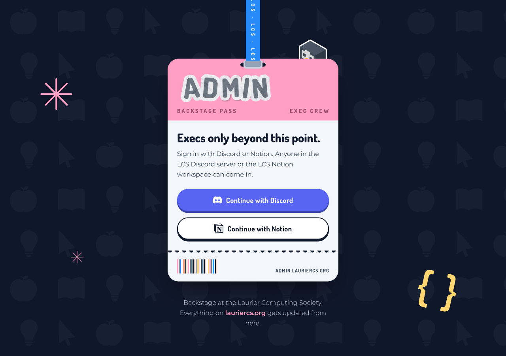
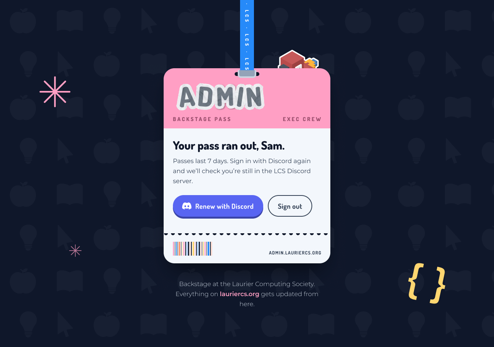
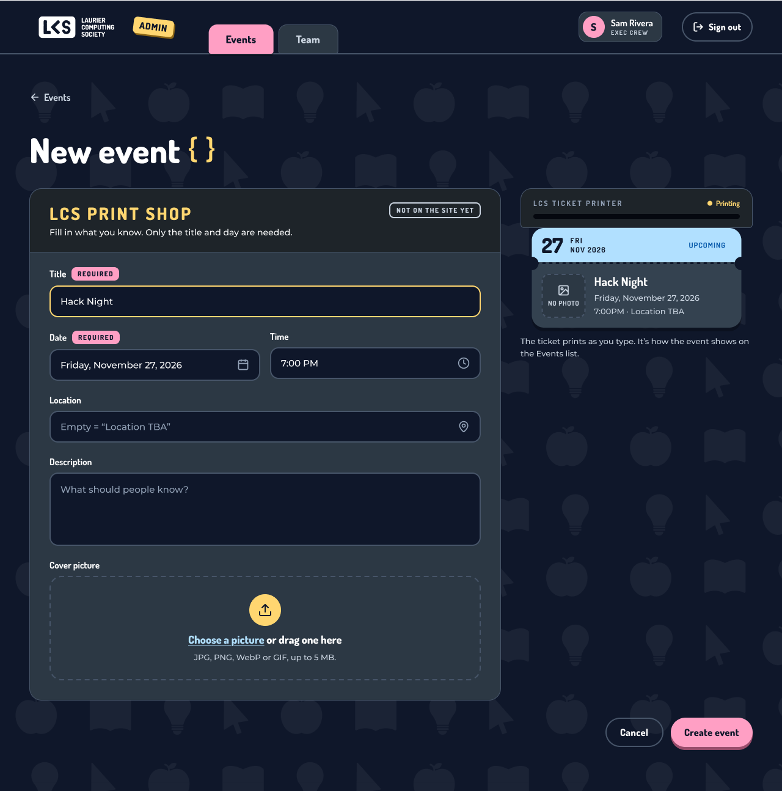
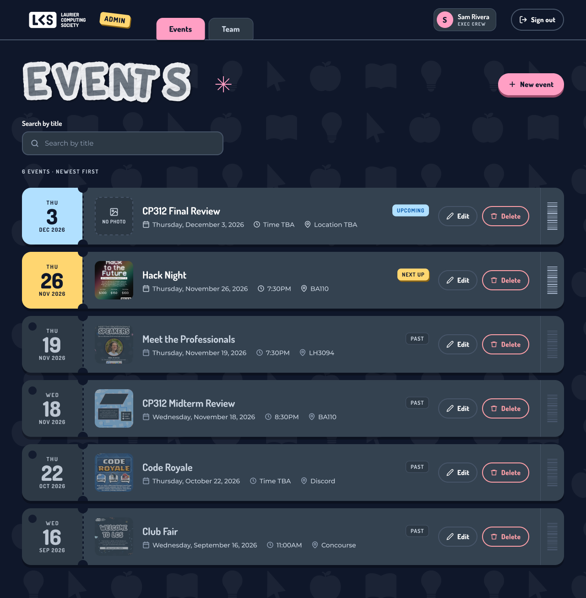
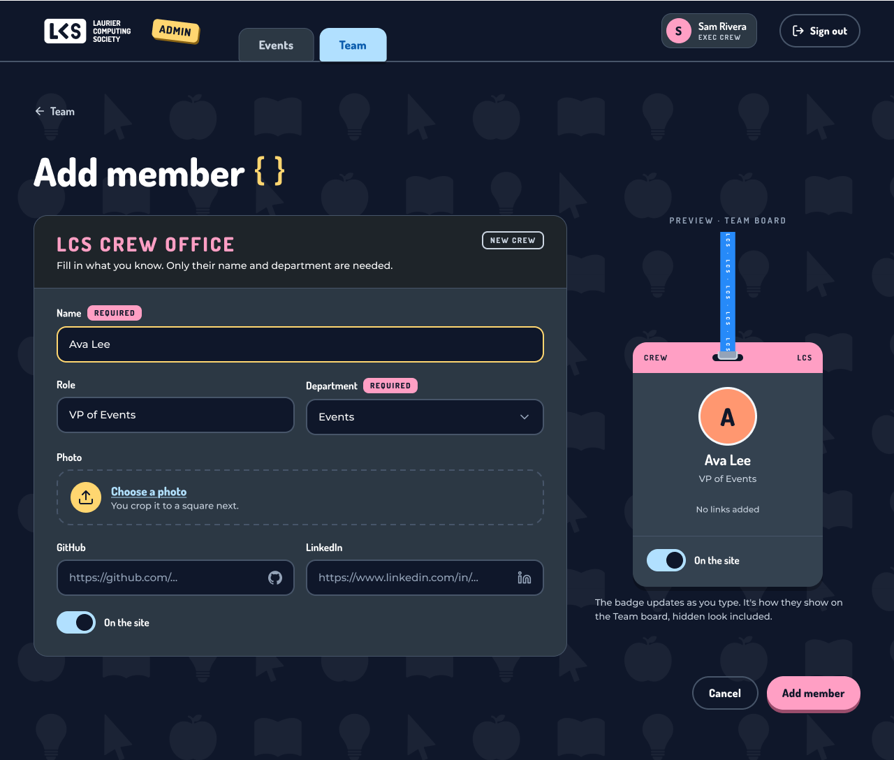
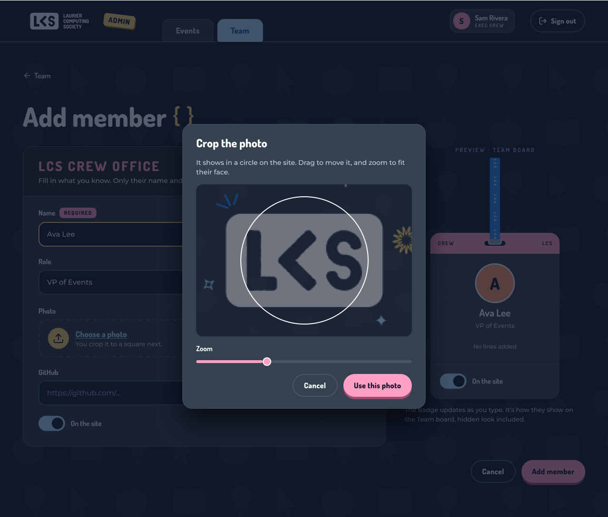
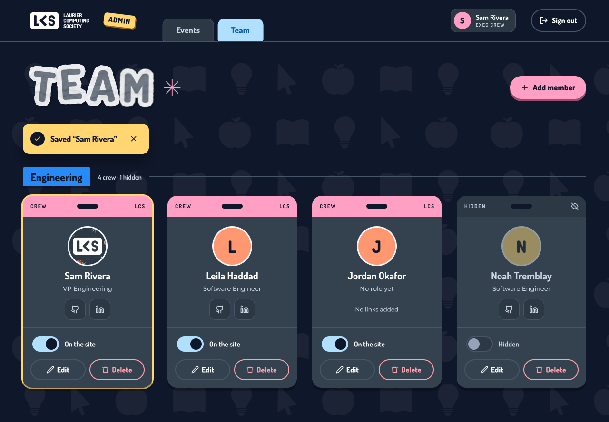

# LCS admin: how-to for execs

How to post events and keep the team page up to date on [lauriercs.org](https://lauriercs.org), without asking
eng. Everything happens at **[admin.lauriercs.org](https://admin.lauriercs.org)**. It works on a phone too.

- [Getting in](#getting-in)
- [Events](#events)
- [Team](#team)
- [Spreadsheets: export and import](#spreadsheets-export-and-import)
- [What shows on the site, and when](#what-shows-on-the-site-and-when)
- [When something goes wrong](#when-something-goes-wrong)

## Getting in

**Who can get in:** anyone in the **LCS Discord server** or the **LCS Notion workspace**. Nobody has to add you
by hand. If you're not in either, ask a VP of Engineering.

1. Go to [admin.lauriercs.org](https://admin.lauriercs.org).
2. Press **Continue with Discord** or **Continue with Notion** and sign in with the account that is in the LCS
   server or workspace.
3. The pass says **Checking your pass…**, then **Access granted**, and the Events page opens.

**"You're not on the list (yet)"** means that account isn't in the LCS Discord server or Notion workspace. Join
it (or sign in with the account that is), then press **Check again**.

**Your pass lasts 7 days.** After that the dashboard shows **Your pass ran out**. Press **Renew with Discord** (or
Notion) and sign in again; nothing you saved is lost.

## Events

### Post an event

1. On **Events**, press **New event**.
2. Fill in the sheet. Only **Title** and **Date** are needed:
   - **Time:** leave it empty if it isn't set yet.
   - **Location:** leave it empty and the site says "Location TBA".
   - **Description:** what people should know, like what to bring.
   - **Cover picture:** press **Choose a picture** (or drag one in). JPG, PNG, WebP or GIF, up to 5 MB.
3. The ticket on the right shows how the event will look as you type.
4. Press **Create event**. The ticket is stamped **Issued** and you're back on Events, which says
   `Saved "<your title>".`

### Change or delete an event

1. On **Events**, find the event (the search box looks through titles) and press **Edit**.
2. Change what you need and press **Save changes**. Only what you changed is saved.
   - To swap the picture, press **Choose a different picture**. To take it off, press **Remove picture**.
3. To delete an event, press **Delete** on it in the list, then **Delete** again to confirm. It's gone from the
   site straight away and can't be undone.

## Team

### Add someone

1. On **Team**, press **Add member**.
2. Fill in the sheet. Only **Name** and **Department** are needed:
   - **Role:** like "VP of Events".
   - **Photo:** press **Choose a picture**, then drag the photo to centre their face and use **Zoom** to fit it
     in the circle. Press **Use this photo**.
   - **GitHub** and **LinkedIn:** paste the whole link, like `https://github.com/their-name`. Leave them empty if
     they don't have one.
   - **On the site:** on by default. Turn it off to add them without showing them yet.
3. The badge on the right shows how they'll look on the Team board.
4. Press **Add member**. The badge drops onto its lanyard and you're back on Team.

### Hide someone who has left

On **Team**, turn off the **On the site** switch on their badge. It saves straight away: the badge goes grey
and says **Hidden**, and they disappear from the site. Turn it back on to show them again.

To remove someone for good, press **Delete** on their badge, then **Delete** again to confirm.

### Change someone's details

On **Team**, press **Edit** on their badge, change what you need and press **Save changes**.

## Spreadsheets: export and import

Handy for adding a whole term of events or a new exec team at once.

1. On **Events** or **Team**, press **Export CSV**. You get a spreadsheet of everything there, hidden team
   members included. Pictures aren't in it.
2. Open it in Google Sheets or Excel and edit it:
   - **Change a row** to change that event or member. Leave its **id** as it is.
   - **Add a row with the id left empty** to add a new one.
   - Deleting a row does nothing: the event or member stays. Delete them in the admin instead.
   - Write dates as year-month-day, like `2026-11-20`, times like `7:30PM`, and `is_public` as `true` or `false`.
     Excel may change dates to `11/20/2026` when it saves. Use Google Sheets, or in Excel set the date column
     to **Text** before you type in it.
3. Save it as a CSV file. Back in the admin, press **Import CSV**, then **Choose a CSV file**.
4. Check what it will do: new and changed rows show as the tickets or badges they'll be, with each change listed
   under them. If something in the file is wrong, every problem is listed by its row number: fix them in the
   spreadsheet and choose the file again.
5. Press **Import**. Everything is saved at once, or, if anything goes wrong, nothing is.

Pictures and photos are added in the admin afterwards, with **Edit**.

## What shows on the site, and when

- **Events** and **team members who are on the site** show on lauriercs.org as soon as you save. Reload the page
  to see them.
- **Hidden** team members never show on the site, but stay in the admin so you can bring them back.
- Event times show exactly as saved, like "7:30PM".

## When something goes wrong

- **"… couldn't be saved."** Nothing is lost: what you typed is still on the form. Wait a moment and press save
  again.
- **"The door's jammed."** on the login: wait a minute and press **Try again**. If it keeps happening, sign out
  and sign back in.
- **Anything else, or it keeps failing:** message the eng team in the LCS Discord with what you were doing and a
  screenshot.
