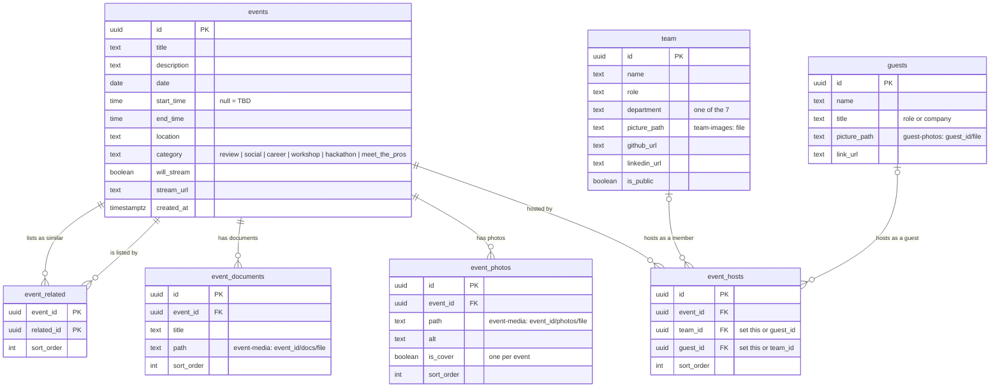

# Supabase v2: the database for the redesigned site

This folder plans the new database the Astro redesign (`apps/site`, issue #200) reads from. **Nothing here has
been run against LCS-Site yet.** Review it first; every script is run by hand, in order, after that.

v2 lives in its own Postgres schema, `v2`, inside the same Supabase project. The current tables in `public`
(`events`, `team`, `admins`) and the current buckets (`events-images`, `team-images`) are never changed, so the
live site and the current admin keep working while the new site is built. The admin moves over to v2 later.

## Why

The current `events` table is one picture and a blurb. The redesign needs more:

| Feature on the new site | What it needs in the database |
| --- | --- |
| Calendar, upcoming and past events | A real `start_time` / `end_time` instead of text like `"7:30 PM - 9:00 PM"` |
| Archive filters, What We Host | `events.category`: `review`, `social`, `career`, `workshop`, `hackathon`, `meet_the_pros` |
| Photo gallery with a cover for cards | `event_photos`, many per event, exactly one `is_cover` |
| Slides, review packages and other files on an event | `event_documents` plus files in storage (all public) |
| Who's running an event, on or off the team | `event_hosts`, each a team member **or** a guest; `guests` for people outside LCS |
| Similar past events on an event page | `event_related`, hand-picked in the admin |
| "Will it be streamed?" in the YouTube section, and the recording | `events.will_stream`, `events.stream_url` |
| Meet the Team grouped by department | `team` as today |

Decided against: a `series` table. Category covers "what kind of event" and hand-picked related events cover
"see also", so series would overlap with both. Hack to the Future is an event with category `hackathon`; its
recap page stays separate and isn't in the database for now. YouTube videos come from the channel feed.

## Diagram



## How the pieces fit

- **An event** owns its photos, documents, hosts and related-event picks. Deleting an event deletes all of those
  (`on delete cascade`). It doesn't delete the team members, guests or other events they pointed at.
- **Cover photo:** a unique index allows only one `is_cover` photo per event. Cards on the home page and the
  archive use it; the event page shows every photo in `sort_order`.
- **Hosts:** a check constraint makes every `event_hosts` row point at exactly one person, a team member or a
  guest. The same person can't be added to the same event twice. Removing a member or guest takes them off
  their events. A team member who isn't public (`is_public = false`) is hidden from the public by the team read
  rule, so they don't show as a host either.
- **Guests** are reusable: a speaker who comes back next term is the same row, linked to both events.
- **Similar past events** are one-way picks: A listing B doesn't make B list A. An event can't list itself.
- **Paths, not URLs:** tables store the path inside a bucket. The site builds the URL with
  `supabase.storage.from(bucket).getPublicUrl(path)`, so a bucket or domain change never means rewriting rows.

### Access (same as phase 1)

Anyone can read everything in v2 except unpublished team members. Only admins (`public.is_admin()`, the same
check the current admin uses) can insert, update or delete. Nobody can truncate through the API.

## Storage

```
event-media/        public, 20 MB per file, images + PDF + PowerPoint
  <event_id>/
    photos/<random>.<ext>
    docs/<random>.<ext>
guest-photos/       public, 5 MB per file, images
  <guest_id>/<random>.<ext>
event-photos/       public, 20 MB per file, images: photos from the camera (v2.photos.path)
company-logos/      public, 2 MB per file, images (no SVG): company logos (v2.companies.logo_path)
team-images/        unchanged, still used by v2.team
events-images/      unchanged, only the live site uses it
```

One folder per event keeps everything for an event together and easy to clean up. Upload with a random or
timestamped name, not the original file name, so two `IMG_0001.jpg`s never overwrite each other. Admin-only
write rules match `events-images` and `team-images`.

## Moving the data

| Today (`public`) | v2 |
| --- | --- |
| `events.id`, `title`, `description`, `date`, `location`, `created_at` | Same, same ids; a location of `"TBD"` becomes null |
| `events.kind` | `category`, plus a few events placed by hand (see `03_populate.sql`). Re-runs keep whatever the admin set |
| `events.time` (text) | `start_time` and `end_time`. `"7:30PM"`, `"7:30 PM"` and `"7:30 PM - 9:00 PM"` are read; anything else (like `"TBD"`) becomes null and is listed by `05_verify.sql` |
| `events.picture_url` (full URL in `events-images`) | A cover row in `event_photos`; the file is copied to `event-media/<event_id>/photos/` |
| `team.*` | Same, same ids; `role` drops the department ("VP of Marketing" becomes "VP"); `picture_url` becomes `picture_path` (the file stays in `team-images`); blank links become null |
| (new) | `will_stream` starts as false; hosts, documents and related events start empty; set them in the admin |

## Running it

Run in the Supabase SQL editor (or `psql`), in order. Each step can be checked before the next.

| Step | File | What it does | Changes `public`? |
| --- | --- | --- | --- |
| 1 | `01_schema.sql` | Creates the `v2` schema, its tables, indexes and access rules | No |
| 2 | `02_storage.sql` | Creates the `event-media` and `guest-photos` buckets and their write rules | No |
| 3 | `03_populate.sql` | Copies events and team from `public` into `v2`; safe to re-run | No (reads only) |
| 4 | `04_copy_event_photos.mjs` | Copies each event's picture into `event-media` (run locally with the service role key; `--dry-run` first) | No (copies only) |
| 5 | `05_verify.sql` | Read-only: row counts, unreadable times, rows deleted since, photos not copied yet | No |
| 6 | Dashboard | Integrations → Data API → Settings → Exposed schemas: add `v2`, so the site can call `supabase.schema('v2')` with the same publishable key | No |
| 7 | `06_categories_and_roles.sql` | Only for a database set up before 2026-11-25: new category list, shorter roles | No |
| 8 | `07_companies_photos_posters.sql` | Adds `companies`, `guests.company_id`, `photos`, `photo_guests` and `events.poster_path` (filled from the covers), and the `event-photos` and `company-logos` buckets | No |
| 9 | `08_fall_2026_speakers.sql` | The Fall 2026 Meet the Professionals speakers and their companies, as the event's hosts (upload their headshots and logos first) | No |
| undo | `99_rollback.sql` | Drops `v2` and the new bucket rules (empty and delete the two buckets in the dashboard) | No |

Until the new site goes live, the current admin still writes to `public`. **Re-run steps 3 to 5 right before
launch** to bring v2 up to date. Re-running updates existing rows from `public` but never overwrites
v2-only fields (category, streaming, hosts, documents, related events, extra photos). Events deleted from
`public` aren't deleted from v2 automatically; `05_verify.sql` lists them.

Once it's been reviewed and applied, the SQL files can be turned into dated files in `migrations/` so the
migration history matches what's live.

These scripts were tested on a local Postgres 17 with stand-ins for `storage` and `public.is_admin()`: a run
from scratch, a second populate run (no duplicates), the host check rejecting a row with no person, and the
rollback leaving `public` as it was.

## Later

- `site_data_versions` areas for the v2 tables, so the site's cache refreshes when v2 changes.
- Moving the admin to v2, then retiring `public.events`, `public.team` and `events-images`.
- Once the admin and the site read posters from `events.poster_path` and photos from `v2.photos`: dropping
  `v2.event_photos`, and making `03_populate.sql` write `poster_path` instead of cover rows.
